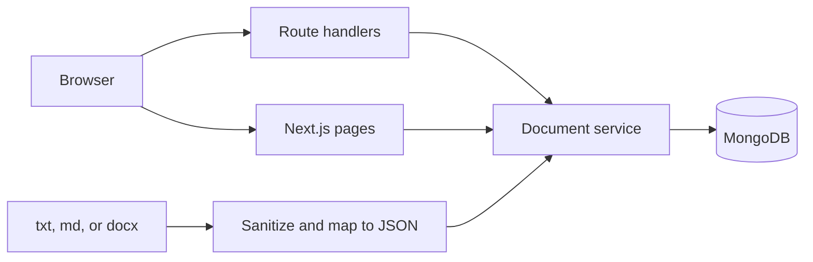

# Architecture

Folio is one Next.js app. The browser talks to route handlers, those handlers call a document service, and the service writes MongoDB. There is no separate frontend API client.

## What I optimized for

The review has to show four things quickly: a document can be written, formatting survives a refresh, a file can become a document, and two people do not have the same access. I spent the time on those paths.

I did not spend it on realtime collaboration. A cursor overlay without a real merge would fail as soon as two people typed, and building a CRDT would have crowded out sharing and import. The honest rule is on the page: the last successful save wins, and the other person is told to reload.

## Storage

MongoDB, through `MONGODB_URI`. Locally that comes from `.env`. On Vercel it is a project environment variable. The same database is what a refresh and a second visitor read.

Collections:

- `users` — three seeded people
- `documents` — title, TipTap JSON, a plain-text preview, owner, last editor, timestamps
- `shares` — document, user, `editor` or `viewer`
- `meta` — so the sample documents are inserted once, not recreated on every boot

Deletes cascade from a document to its shares.

## Auth

Sign-in checks the email and a scrypt password hash, then sets an HTTP-only cookie. The cookie is `payload.signature`, HMAC-SHA256, with a 7-day expiry. A bad signature or an expired token is treated as signed out.

This is demo auth. The password is public, there is no reset flow, and `SESSION_SECRET` must be set in production. Passwords are still hashed so the code does not teach storing them in plaintext.

`COOKIE_SECURE` defaults to true only when `NODE_ENV=production`. For `npm run dev`, or for `npm start` on http://localhost, leave it false. Set it true behind HTTPS.

## Sharing

| Action | Owner | Editor | Viewer | No access |
| --- | --- | --- | --- | --- |
| Read | yes | yes | yes | no |
| Edit text and title | yes | yes | no | no |
| Share or change a role | yes | no | no | no |
| Delete | yes | no | no | no |

The library is split into **Your documents** and **Shared with you** so the role is visible before the document is opened. Anyone who can open a document can see the roster. With three seeded people, hiding it would make the demo harder to understand. Only the owner can change it.

A missing document is 404. A document that exists but is not shared with you is 403.

## Documents

The editor is TipTap. Saves store its JSON, not HTML. The same schema is used to reject a payload the editor could not reopen.

Autosave waits briefly, sends the title, the JSON, and the `updatedAt` the editor last saw, and ignores a response that is no longer the latest in-flight save. If `updatedAt` moved and the content actually changed, the server returns 409 and the editor stops writing until reload. An identical retry does not bump the timestamp, so a repeated save does not create a false conflict.

Opening a document does not save by itself. The editor marks itself ready only after TipTap has applied the stored JSON.

## Import

`.txt`, `.md`, and `.docx` become a new document owned by the person who uploaded them. Word files go through Mammoth to HTML. Markdown goes through `marked`. Text is escaped and split into paragraphs.

All of that HTML is then sanitized to a small tag set and mapped into TipTap nodes: paragraphs, headings 1–3, lists, bold, italic, underline, strike, code, quotes, and horizontal rules. Headings below H3 become H3. Tables become text lines. Images, scripts, and styles are dropped. The result has to pass the editor schema before it is stored.

That mapper is intentional. Generating JSON inside a server-side DOM would hide which formatting actually survives.

Export walks the same JSON back out to Markdown. It is a convenience, not a lossless round trip. Underline is written as `<u>` because Markdown has no underline.

## What I would not pretend is done

- Two editors can still lose a paragraph if they type at the same time. The 409 check stops a blind overwrite. It does not merge.
- There is no history beyond the current document.
- The share dialog is not a full focus trap.
- Import size is capped at 2 MB and document JSON at 400k characters. That is a guardrail, not an abuse story for the public internet.
